# ⛽ Controle de Combustível

Aplicativo em **Flutter** para registrar os abastecimentos de um veículo e acompanhar os gastos com combustível e o consumo ao longo do tempo.

> Atividade Substitutiva da Prova 1 — Programação para Dispositivos Móveis I (Fatec) — Prof. Arley

## Funcionalidades

### 1. Cadastro do veículo
- Cadastro de **apenas um veículo por vez**: marca, modelo, ano e cilindrada do motor.
- **Marcas e modelos consultados na BrasilAPI** (tabela FIPE). A lista de modelos é carregada de acordo com a marca escolhida; os campos permitem digitar para filtrar.
- Para cadastrar outro veículo é preciso **excluir o atual**. A exclusão pede **confirmação** e remove também **todos os abastecimentos** associados.

### 2. Registro de abastecimentos
- Tipo de combustível (**etanol, gasolina ou diesel**), preço por litro (R$), quilometragem, litros e data/horário.
- **Valor total calculado automaticamente** (preço por litro × litros), exibido em tempo real no formulário.
- Edição (toque no item) e exclusão de abastecimentos.
- Validação da quilometragem: precisa ser maior que a do abastecimento anterior e menor que a do seguinte.

### 3. Persistência local
- Veículo e abastecimentos ficam salvos **no dispositivo** (`shared_preferences`, em JSON) e continuam disponíveis após fechar e abrir o app.

### 4. Dashboard e gráficos
Considerando que todo abastecimento completa o tanque, a partir do **segundo** registro:

| Indicador | Fórmula |
|---|---|
| Distância percorrida | km atual − km do abastecimento anterior |
| Consumo (km/L) | distância ÷ litros do abastecimento atual |
| Custo (R$/km) | valor total do abastecimento atual ÷ distância |

O **primeiro abastecimento** é a referência inicial e **não exibe** km/L nem R$/km.

O dashboard mostra:
- Cartões com total gasto, total de litros, média de km/L e média de R$/km;
- Gráfico de barras com o **valor de cada abastecimento**;
- Gráfico de linha com a **evolução do consumo (km/L)**;
- Gráfico de linha com a **evolução do custo por km (R$/km)**;
- Tabela com os indicadores de cada abastecimento.

## Capturas de tela

| Sem veículo | Marcas (BrasilAPI) | Modelos por marca | Cadastro |
|---|---|---|---|
| 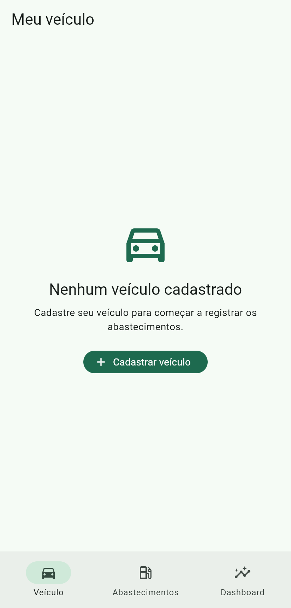 | 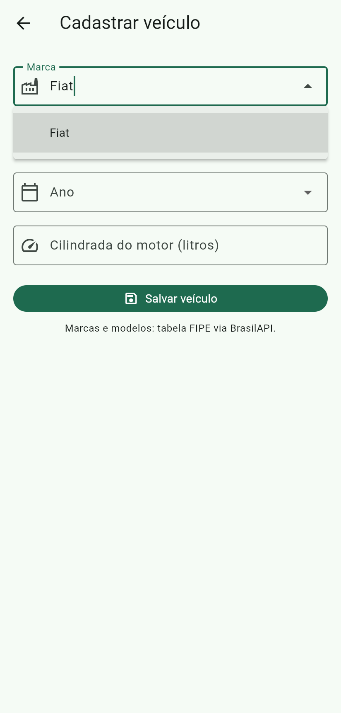 | 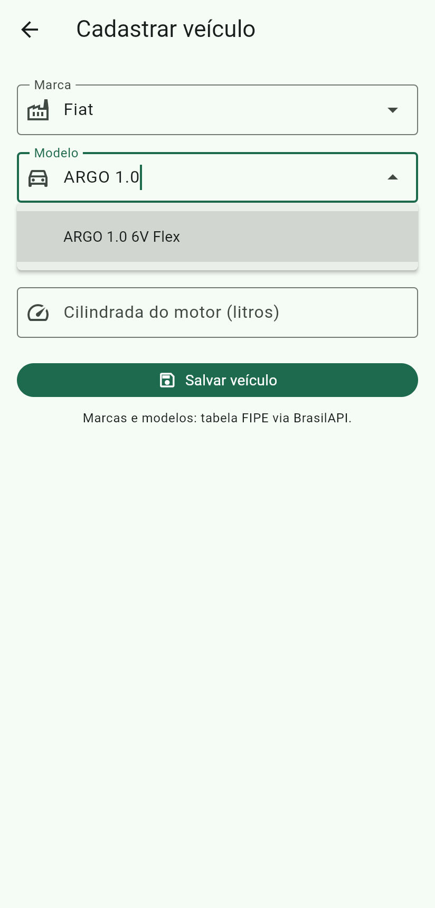 | 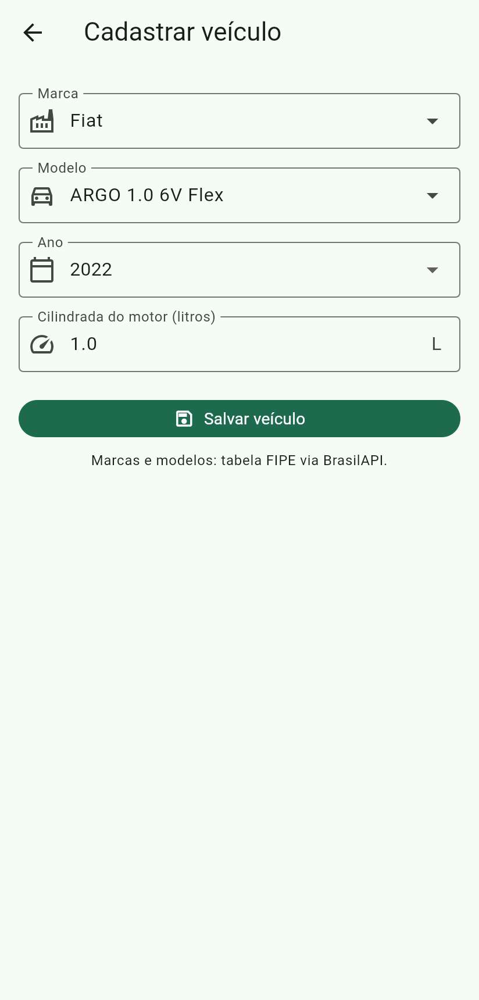 |

| Veículo | Abastecimentos | Novo abastecimento | Validação de km |
|---|---|---|---|
| 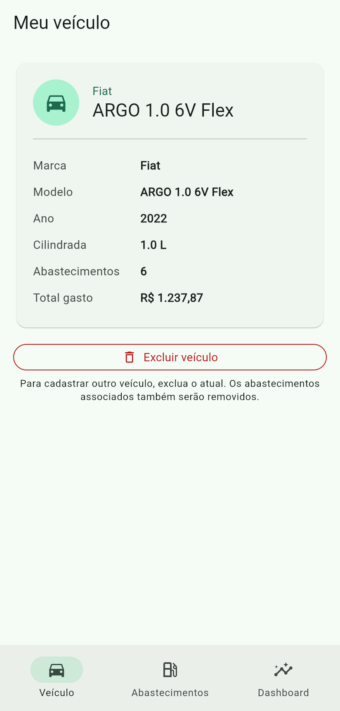 | 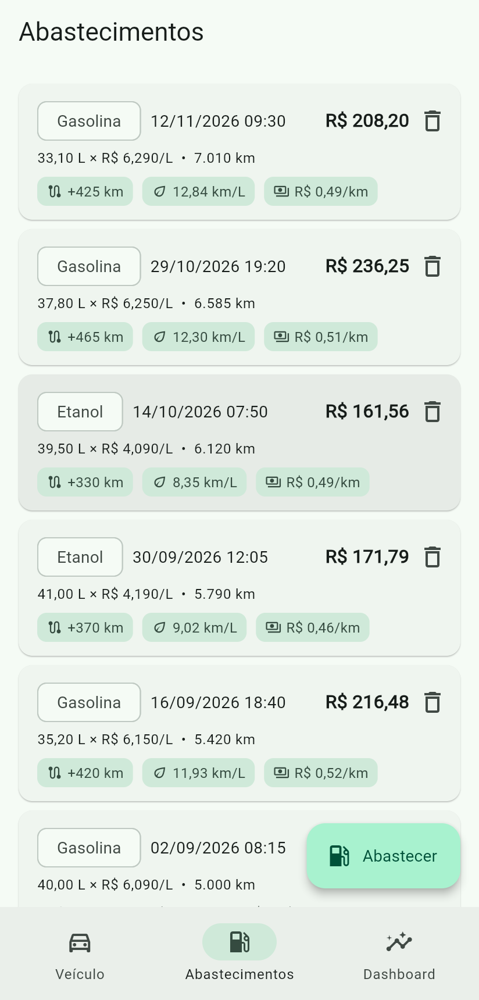 | 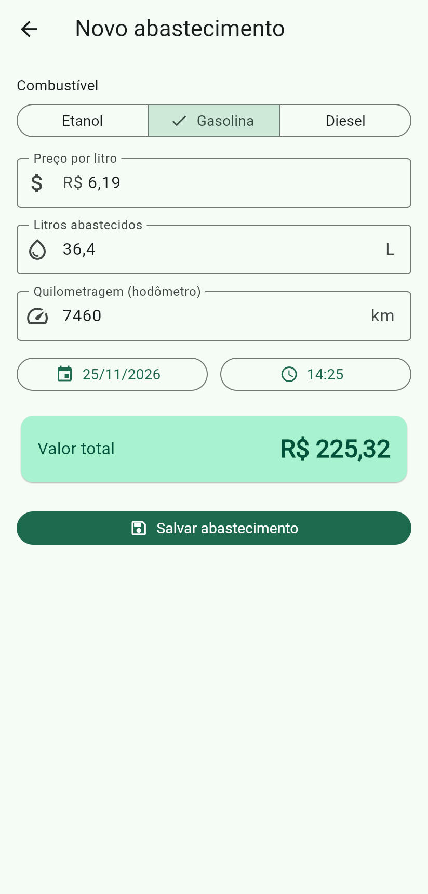 | 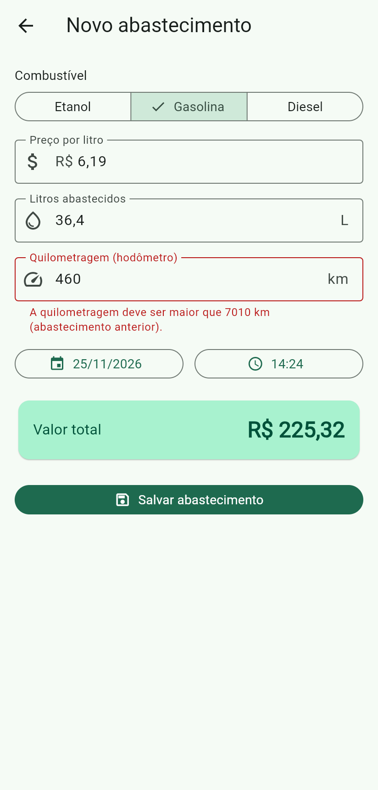 |

| Dashboard | Gráficos | R$/km e tabela | Exclusão com confirmação |
|---|---|---|---|
| 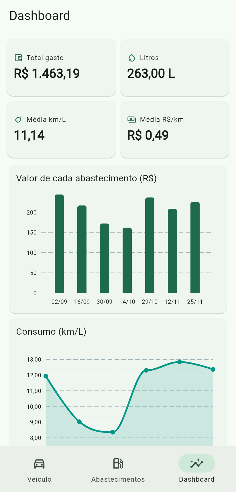 | 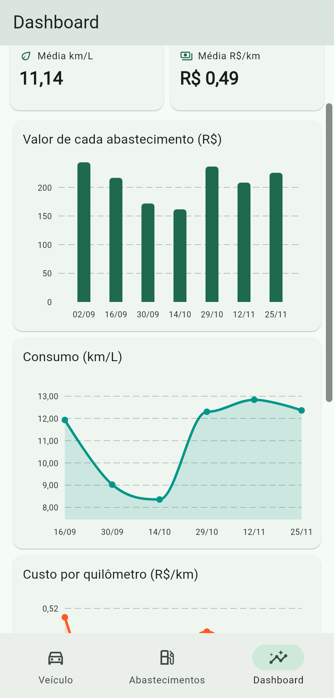 | 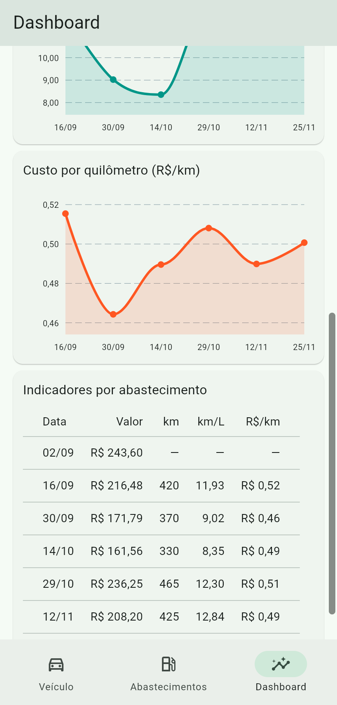 | 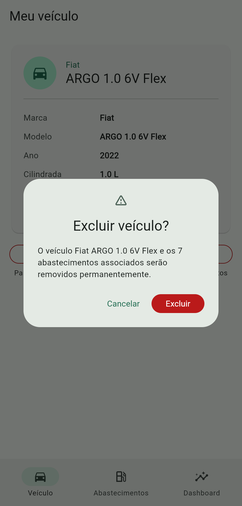 |

## Como executar

Pré-requisitos: [Flutter SDK](https://docs.flutter.dev/get-started/install) 3.x (Dart 3) e um emulador/dispositivo Android, iOS ou navegador Chrome.

```bash
git clone https://github.com/teodoroooo/controle-combustivel-flutter.git
cd controle-combustivel-flutter
flutter pub get

# Android (emulador ou celular conectado)
flutter run

# ou no navegador
flutter run -d chrome
```

Rodar os testes:

```bash
flutter test
```

Gerar APK:

```bash
flutter build apk --release
```

## API utilizada

**[BrasilAPI — FIPE](https://brasilapi.com.br/docs#tag/FIPE)** (pública, sem autenticação):

| Uso | Endpoint |
|---|---|
| Listar marcas de carros | `GET https://brasilapi.com.br/api/fipe/marcas/v1/carros` |
| Listar modelos da marca | `GET https://brasilapi.com.br/api/fipe/veiculos/v1/carros/{codigoMarca}` |

## Bibliotecas adotadas

| Pacote | Uso |
|---|---|
| [`http`](https://pub.dev/packages/http) | Requisições à BrasilAPI |
| [`shared_preferences`](https://pub.dev/packages/shared_preferences) | Persistência local do veículo e dos abastecimentos |
| [`fl_chart`](https://pub.dev/packages/fl_chart) | Gráficos de barras e de linha do dashboard |
| [`intl`](https://pub.dev/packages/intl) | Formatação de moeda (R$), números e datas em pt-BR |
| `flutter_localizations` | Calendário/relógio e textos do Material em português |

## Estrutura do projeto

```
lib/
├── main.dart                       # Inicialização, tema e localização
├── controllers/
│   └── app_controller.dart         # Estado (ChangeNotifier) + AppScope (InheritedNotifier)
├── models/
│   ├── vehicle.dart                # Veículo
│   ├── refuel.dart                 # Abastecimento + FuelType
│   └── refuel_stats.dart           # Cálculo de distância, km/L, R$/km e resumo
├── services/
│   ├── fipe_api_service.dart       # Cliente da BrasilAPI (FIPE)
│   └── storage_service.dart        # Persistência local
├── screens/
│   ├── home_screen.dart            # Navegação inferior (Veículo / Abastecimentos / Dashboard)
│   ├── vehicle_screen.dart         # Dados do veículo + exclusão
│   ├── vehicle_form_screen.dart    # Cadastro com marcas/modelos da API
│   ├── refuels_screen.dart         # Lista de abastecimentos
│   ├── refuel_form_screen.dart     # Novo/editar abastecimento
│   └── dashboard_screen.dart       # Indicadores e gráficos
└── utils/
    └── formatters.dart             # Formatação e parsing de números (vírgula/ponto)
test/
├── refuel_stats_test.dart          # Fórmulas dos indicadores
├── app_controller_test.dart        # Persistência, veículo único, exclusão em cascata
└── fipe_api_service_test.dart      # Cliente da API com MockClient
```
